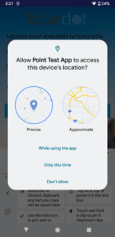

Location Permission & Notifications Best Practices
============================================================

Location permissions
--------------------

Prior to starting any Rezolve Geo Services (Geo-triggering or Tempo), the app must request and be granted location permission. When requesting location permission it is important to make the request in context and convey the value the user will be gaining from granting the permission.

For apps targeted Android 11 and lower, only [ACCESS_FINE_LOCATION](https://developer.android.com/reference/android/Manifest.permission#ACCESS_FINE_LOCATION) permission needs to be requested and granted.

When targeting Android 12 and onwards the app must request both [approximate location](https://developer.android.com/training/location/permissions#request-location-access-runtime) and [precise location](https://developer.android.com/training/location/permissions#accuracy). The app should request [ACCESS_COARSE_LOCATION](https://developer.android.com/reference/android/Manifest.permission#ACCESS_COARSE_LOCATION) and [ACCESS_FINE_LOCATION](https://developer.android.com/reference/android/Manifest.permission#ACCESS_FINE_LOCATION).

The user may choose to grant access to either approximate or precise as shown below:



If the app has not been granted permission to access precise location data the Geo-triggering and Tempo services will not start, and the start method will return a [LocationPermissionNotGrantedError](https://android-docs.bluedot.io/-rezolve%20-point%20-s-d-k/au.com.bluedot.point.error/-location-permission-not-granted-error/index.html). To ensure the location permission has been granted, it is important to implement the permission checking and requesting process prior to any attempt to start a Rezolve Point SDK service.

Additionally, from Android 10 onwards, if the Geo-triggering service is not run as a [foreground service](https://developer.android.com/guide/components/foreground-services), the `ACCESS_BACKGROUND_LOCATION` [permission must be requested](https://developer.android.com/training/location/permissions#background) and granted in order for the Geo-triggering service to access location data and function when the app is not in use. From Android 11 onwards, the request to access background location data [must be made separately](https://developer.android.com/about/versions/11/privacy/location#request-background-location-separately) from the initial request to access location data. Even when granted permission to access background location data the access is limited to only a [few updates per hour](https://developer.android.com/training/location/background#limit-updates) while the app is not in use. The Play Store also has [restrictions](https://support.google.com/googleplay/android-developer/answer/9799150) on how apps published on the store may utilise background location data.

Foreground service and persistent notification
----------------------------------------------

:::info
As of SDK 19.0.0, the SDK **no longer declares, starts, or displays a foreground service** for either Geo-triggering or Tempo, in order to comply with Google Play policy which no longer permits the `FOREGROUND_SERVICE_LOCATION` foreground service type to be used for geofencing (effective **October 28, 2026**). Your app now owns the foreground service, notification, and manifest `<service>` declaration. See the [Migration Guide to Point SDK V19.0.0 for Android](./Migration%20Guides/Migration%20guide%20to%20SDK%2019.0.0%20for%20Android.md) for full details if you are upgrading from an earlier version. The sections below describe the current (19.0.0+) model.
:::

Given the restrictions on accessing location data from the background, linking the Geo-triggering service to a foreground service delivers noticeably lower location-update latency - but it is only recommended **if your app independently qualifies for a `FOREGROUND_SERVICE_LOCATION`-typed service under current Google Play policy** (see the note above; geofencing alone no longer qualifies as of October 28, 2026). If your app has no other foreground-service-eligible use case, run Geo-triggering without a linked service instead. **Tempo always requires a linked foreground service to start**, regardless of this policy change, since Tempo's active navigation tracking is itself an approved foreground service use case. Implementing your own [foreground service](https://developer.android.com/guide/components/foreground-services) is the best practice for ensuring users are fully aware of how and when their location is accessed and also for the most efficient use of system resources. When a foreground service is running, there will be a persistent notification in the notification tray informing the user that your app is accessing the device location when the app is in the foreground and background during the lifecycle of the Geo-triggering or Tempo services. Foreground services must always be started while the app is in use and in the foreground.

As per latest recommendation from [Google](https://support.google.com/googleplay/android-developer/answer/13392821?hl=en#zippy=%2Cwhat-is-a-foreground-service-permission-and-does-it-need-to-be-granted-by-the-user-before-starting-a-foreground-service%2Cwhat-is-changing-for-foreground-services-in-android%2Chow-do-i-know-what-foreground-service-type-to-use) you'll need to add the following permissions in the Android Manifest if you plan to link a foreground service:

```xml title="AndroidManifest"
 // Required Android 14 onwards
 <uses-permission android:name="android.permission.FOREGROUND_SERVICE_LOCATION" />
 <uses-permission android:name="android.permission.POST_NOTIFICATIONS"/>   
 <uses-permission android:name="android.permission.FOREGROUND_SERVICE" />       //Required since Android 9
```

* And if it is targeting **Android 13** onwards then for using a Foreground Service with Geo-Trigger/Tempo [`POST_NOTIFICATIONS`](https://developer.android.com/develop/ui/views/notifications/notification-permission) is required to be declared in app manifest as below:

```xml title="AndroidManifest"
 // Required Android 13 onwards
 <uses-permission android:name="android.permission.POST_NOTIFICATIONS"/>   
```

> If your app is **Geo-triggering-only** and doesn't need low-latency triggers, `FOREGROUND_SERVICE` / `FOREGROUND_SERVICE_LOCATION` can be dropped entirely.

The SDK no longer owns a foreground service and the `GeoTriggerBuilder`/`TempoBuilder` no longer accept a `notification()`/`notificationId()`. Instead, your app declares and starts its **own** foreground service with its own notification, then links it to the SDK:

```xml title="AndroidManifest"
<service
    android:name=".YourForegroundService"
    android:exported="false"
    android:foregroundServiceType="location" />
```

```kotlin
class YourForegroundService : Service() {

    override fun onCreate() {
        super.onCreate()
        try {
            startForeground(NOTIFICATION_ID, buildNotification())
            ServiceManager.getInstance(applicationContext).linkForegroundService()
        } catch (e: Exception) {
            stopSelf()
        }
    }

    override fun onDestroy() {
        ServiceManager.getInstance(applicationContext).unlinkForegroundService()
        super.onDestroy()
    }

    override fun onBind(intent: Intent?): IBinder? = null
}
```

Geo-triggering and Tempo share a **single, shared link state** (`ServiceManager.isForegroundServiceLinked`) - not one per feature. If your app runs the Geo-triggering service and Tempo service simultaneously, both share the **one** linked foreground service; there is no separate notification ID concept to manage per feature.

Starting your foreground service for Geo-triggering from the background is not recommended. If your use case requires it, add the `ACCESS_BACKGROUND_LOCATION` permission to your app's manifest and ensure the user has granted "Allow all the time" location access - otherwise the foreground service will fail to start from the background and may cause a crash or exception. Add the permission as follows:

```xml title="AndroidManifest"
<uses-permission android:name="android.permission.ACCESS_BACKGROUND_LOCATION" />
```

Services running in the background consume device resources such as battery life, CPU time and memory, potentially resulting in bad user experiences. To mitigate this problem, since the Oreo release of the Android operating system,  a number of limitations have been applied to the operation of background services. Android 12 also added new restrictions for apps targeting Android 12 (API level 31) onwards. Most significantly, there are further restrictions on the ability to start [foreground](https://developer.android.com/guide/components/foreground-services) services while running in the background, except for [a few special cases](https://developer.android.com/about/versions/12/foreground-services#cases-fgs-background-starts-allowed).
